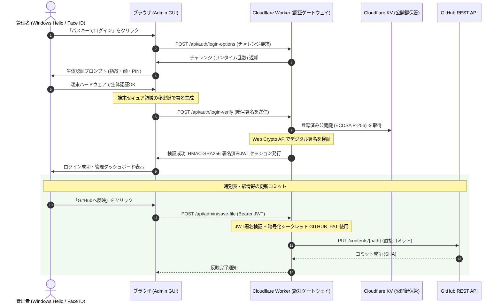

# 真岡鐵道 運行管理システム - パスキー（WebAuthn / FIDO2）導入マニュアル

## 1. 概要とセキュリティ強化の背景

真岡鐵道運行ポータルの管理画面（Admin Panel）は、時刻表データ（`timetable.json`）や駅詳細情報（`stations.json`）をリポジトリへ直接コミットする重要な権限を持っています。

従来のGoogle Apps Script（GAS）を用いたパスワード認証には以下のセキュリティ課題がありました：
1. **パスワード漏洩リスク**: 平文パスワードの送信・ブルートフォース攻撃に対する耐性の限界
2. **フィッシング耐性の欠如**: 偽の管理画面による認証情報詐取のリスク
3. **パブリックURLの露出**: GASエンドポイントURLが公開フロントエンドに記述されているため、第三者から直接APIを叩かれるリスク

これを解決するため、**現代のWebで最も強固な認証技術である「パスキー（FIDO2 / WebAuthn）」および「Cloudflare Workers 認証ゲートウェイ」** を導入しました。

---

## 2. パスキー（WebAuthn）アーキテクチャの特長



### なぜ最も頑健なのか？
- **公開鍵暗号（ECDSA P-256）**: 秘密鍵は管理者のPC（TPMチップ）やiPhone（Secure Enclave）の内部から決して外部に出ません。サーバーには公開鍵のみが保管されるため、サーバー側からパスワードが漏洩するリスクが原理的にゼロです。
- **オリジンバインド（完全フィッシング耐性）**: ブラウザがアクセス先ドメイン（`sekitan66325.github.io`）を検証し、正規ドメイン以外では秘密鍵が動作しないため、巧妙な偽サイトによる認証情報詐取が100%不可能です。
- **GitHub PATの保護**: GitHubのパーソナルアクセストークン（PAT）はCloudflare Worker内部の暗号化環境シークレット（Encrypted Secret）として厳重に隔離され、公開フロントエンドJSには一切露出しません。

---

## 3. Cloudflare Worker のセットアップ手順

Cloudflare Workers は**無料プラン（1日100,000リクエストまで永年無料）**で運用できます。

### ステップ 1: Cloudflare アカウントと Wrangler の準備
1. [Cloudflare](https://dash.cloudflare.com/) で無料アカウントを作成します。
2. 作業PCのターミナル（PowerShell等）で、`cloudflare-auth-worker` フォルダに移動します：
   ```powershell
   cd "cloudflare-auth-worker"
   ```
3. Cloudflare CLI（Wrangler）でログインします：
   ```powershell
   npx wrangler login
   ```
   ブラウザが開くので、Cloudflareアカウントで認可します。

### ステップ 2: Cloudflare KV（公開鍵保管庫）の作成
以下のコマンドで、パスキーの公開鍵とセッションを保管するKV名前空間を作成します：
```powershell
npx wrangler kv:namespace create PASSKEY_KV
```
実行すると以下のような出力が表示されます：
```text
[[kv_namespaces]]
binding = "PASSKEY_KV"
id = "xxxxxxxxxxxxxxxxxxxxxxxxxxxxxxxx"
```
出力された `id` を、`cloudflare-auth-worker/wrangler.toml` の `PASSKEY_KV` の `id` に貼り付けます。

### ステップ 3: 暗号化シークレット（Secrets）の設定
以下の3つの秘密情報をコマンドで設定します（値の入力を求められます）：

1. **GitHub 個人用アクセストークン（GITHUB_PAT）**:
   ```powershell
   npx wrangler secret put GITHUB_PAT
   ```
   *※ GitHubの Settings > Developer settings > Personal access tokens (classic) にて、`repo` 権限を付与したトークンを入力します。*

2. **JWT 署名キー（JWT_SECRET）**:
   ```powershell
   npx wrangler secret put JWT_SECRET
   ```
   *※ ランダムな長い文字列（32文字以上推奨）を入力します。*

3. **初回マスターパスキー登録キー（ADMIN_SETUP_KEY）**:
   ```powershell
   npx wrangler secret put ADMIN_SETUP_KEY
   ```
   *※ 最初のパスキーを登録する際に一度だけ使用する認証キー（例: 任意の英数字パスフレーズ）を入力します。*

### ステップ 4: Cloudflare Worker のデプロイ
```powershell
npx wrangler deploy
```
デプロイが完了すると、専用のWorker URLが表示されます：
```text
https://moka-auth-worker.<あなたのサブドメイン>.workers.dev
```

### ステップ 5: フロントエンド（config.js）の設定
リポジトリ直下の `config.js` を開き、デプロイされたURLを設定します：
```javascript
const CONFIG = window.CONFIG = {
  GAS_API_URL: "https://script.google.com/macros/s/AKfycbyqXXN9JTOBk8u6rPy7zFWnrxHN3GO9r6BI5ociKDKXLMwKfcMp1AXlbxjawelPw0g/exec",
  STATUS_API_URL: "https://script.google.com/macros/s/AKfycbytI6W8gN_iKiRdnruiyDxggxKItUMCNA5KkPIkLtEhqgZxkmkOIOeLHxHO4OneRdrZ5g/exec",
  UNYOU_SPREADSHEET_ID: "1tzgW4fok2NkcoO2816NcEYSw7zv_jeobifrPIqh4vQY",
  AUTH_WORKER_URL: "https://moka-auth-worker.<あなたのサブドメイン>.workers.dev" // ★ ここに設定
};
```

---

## 4. 初回パスキーの登録と日常の利用方法

### 最初のパスキー登録手順
1. ブラウザで管理画面（`admin/index.html`）を開きます。
2. 画面上部の **「🔐 パスキー管理」**（または初回セットアップ）を開きます。
3. 端末名（例: `管理用 PC (Windows Hello)`）と、ステップ3で設定した `ADMIN_SETUP_KEY` を入力します。
4. **「この端末にパスキーを発行・登録する」** をクリックします。
5. OSのダイアログ（Windows Hello 顔認識 / 指紋 / PIN、またはMac Touch ID / iPhone Face ID）が表示されるので、生体認証を実行します。
6. 「パスキーの登録が完了しました」と表示されればセットアップ完了です！

### 日常のログイン手順
1. `admin/index.html` へアクセスします。
2. **「🔒 パスキーでログイン (生体認証)」** ボタンを1クリックします。
3. Windows Hello（顔・指紋）またはスマートフォンの生体認証がポップアップするので、顔を合わせるか指を置くだけでログイン完了です。パスワード入力は不要です。

### 複数端末の登録（iPhoneやノートPCを追加したい場合）
1. 既にパスキーでログイン済みの管理画面で、右上の **「🔐 パスキー管理」** ボタンを押します。
2. 「新しい端末をパスキー登録」フォームに新しい端末名を入力して登録ボタンを押すだけで、現在のログイン権限を引き継いで2台目以降の端末を追加できます（追加時はADMIN_SETUP_KEYの入力は不要です）。

### 端末の紛失・盗難時の失効手順
1. 別の管理端末から「🔐 パスキー管理」モーダルを開きます。
2. 登録済み一覧から紛失した端末の「削除」ボタンをクリックします。
3. その端末からの生体認証ログインが即座に無効化されます。

---

## 5. 互換性とフォールバック対応

- **パスキー非対応端末での利用**:
  万が一、パスキーに対応していない古いブラウザや環境から緊急アクセスする場合は、ログイン画面下部の「従来のパスワード認証」からログイン可能です。
- **データ更新の自動ルーティング**:
  - パスキーでログインした場合: 最も安全かつ高速な **Cloudflare Worker 経由** でGitHubへ直接コミットされます（待ち時間1秒以内）。
  - 従来のパスワードでログインした場合: 従来のGAS経由のフォールバックルートでコミットされます。
